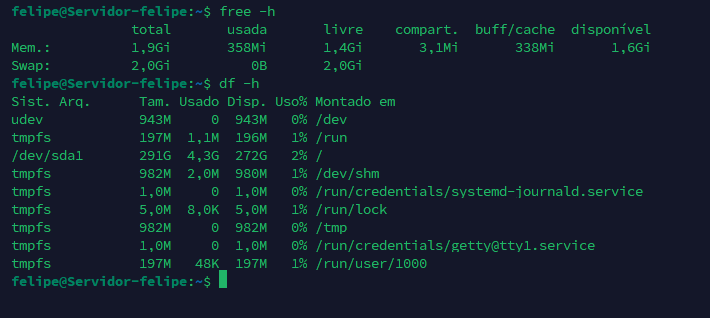
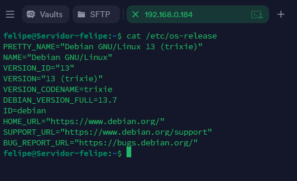
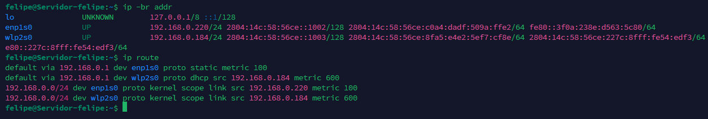
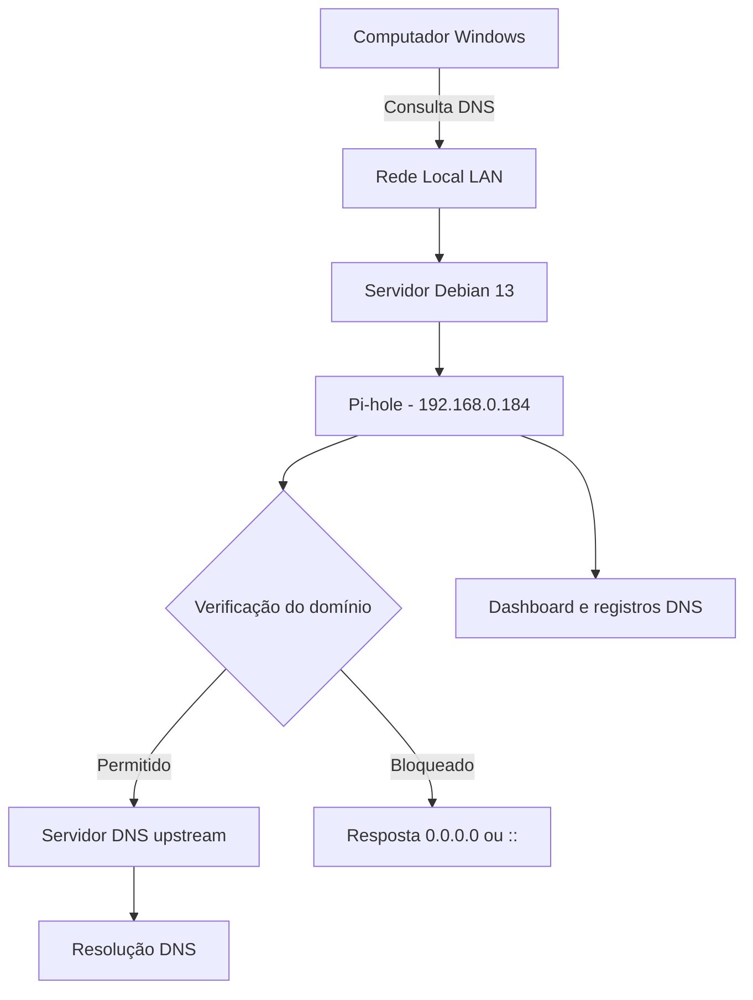
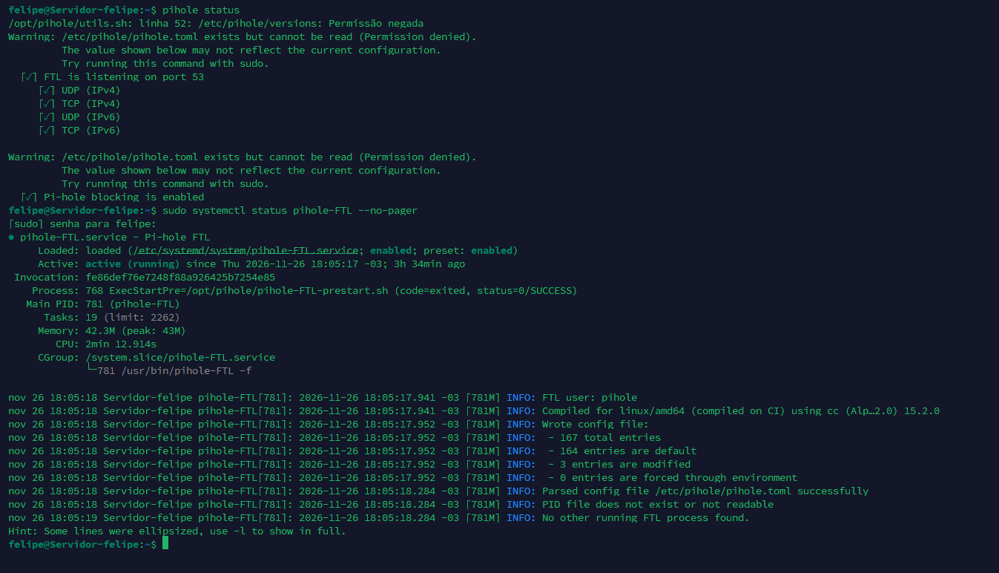
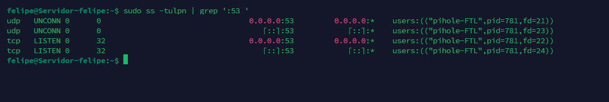
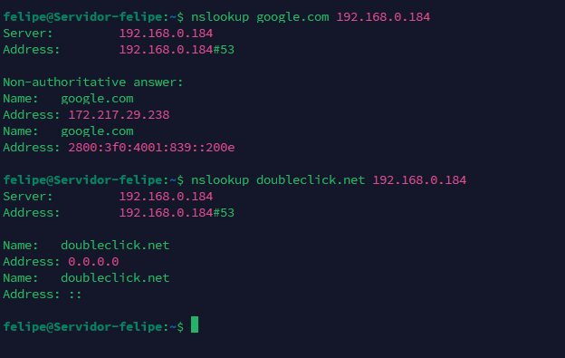
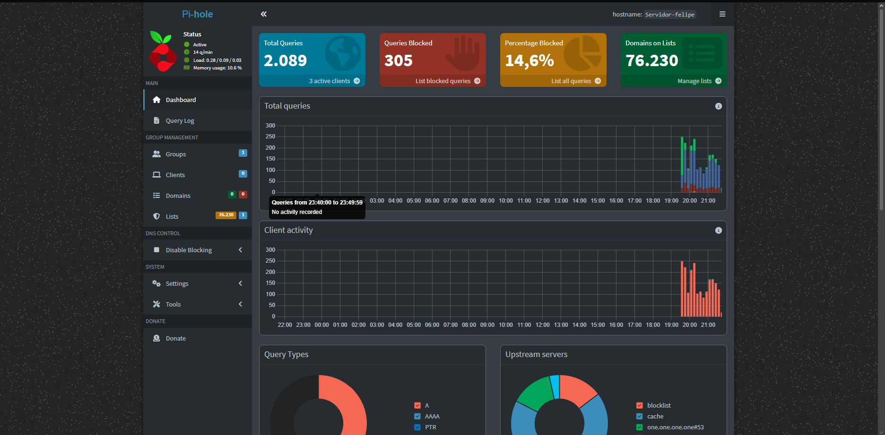
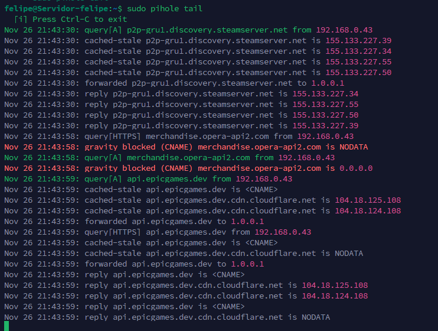

# 🛡️ Linux Server & Pi-hole | DNS Infrastructure Lab


## 📌 Sobre o projeto

Este projeto consiste na implementação de um laboratório de infraestrutura e segurança de redes em ambiente doméstico, utilizando um computador antigo transformado em um servidor Linux dedicado.

A proposta foi reaproveitar um equipamento com recursos computacionais limitados, instalando o Debian GNU/Linux 13 (Trixie) e implementando uma solução de resolução DNS local, monitoramento de consultas e filtragem de domínios por meio do Pi-hole.

O projeto foi desenvolvido com foco no aprimoramento de conhecimentos práticos em administração de sistemas Linux, redes TCP/IP, gerenciamento de serviços, análise de logs, troubleshooting e segurança da informação.

## 🎯 Objetivos

- Implementar um servidor Linux em ambiente físico.
- Reaproveitar hardware de baixo desempenho.
- Administrar serviços e processos Linux.
- Implementar um servidor DNS local.
- Realizar filtragem de domínios de publicidade e rastreamento.
- Monitorar consultas DNS da rede local.
- Realizar testes de conectividade e resolução de nomes.
- Desenvolver conhecimentos em segurança DNS.
- Documentar procedimentos e evidências técnicas.

## 🖥️ 1. Ambiente e infraestrutura

O laboratório foi implementado em um computador físico antigo, dedicado à execução de serviços de infraestrutura na rede doméstica.

| Recurso | Configuração |
|---|---|
| Ambiente | Servidor físico residencial |
| Sistema operacional | Debian GNU/Linux |
| Versão | 13.7 — Trixie |
| Memória RAM | 2 GB |
| Rede | Local — LAN |
| Endereço IP | 192.168.0.184 |
| Serviço principal | Pi-hole |
| Protocolo | DNS |
| Porta DNS | 53 — TCP/UDP |
| Cliente utilizado | Windows |

A escolha de uma distribuição Linux com baixo consumo de recursos permite o reaproveitamento do equipamento sem a necessidade de investimentos adicionais em hardware.

### Recursos computacionais

Para identificar os recursos disponíveis no servidor, foram definidos os seguintes comandos de diagnóstico:

```bash
lscpu
free -h
df -h
```

Esses comandos permitem identificar informações sobre processamento, memória RAM e armazenamento.



## 🐧 2. Instalação do Debian GNU/Linux

A primeira etapa do projeto consistiu na instalação do Debian GNU/Linux 13 (Trixie) no equipamento físico.

O Debian foi escolhido por sua estabilidade, confiabilidade, disponibilidade de ferramentas de administração e possibilidade de utilização em servidores com recursos limitados.

Após a instalação do sistema operacional, a distribuição e sua versão foram identificadas utilizando:

```bash
cat /etc/os-release
```

### Informações do sistema operacional

```text
PRETTY_NAME="Debian GNU/Linux 13 (trixie)"
NAME="Debian GNU/Linux"
VERSION_ID="13"
VERSION="13 (trixie)"
VERSION_CODENAME=trixie
DEBIAN_VERSION_FULL=13.7
ID=debian
```

### Evidência do sistema operacional



## 🌐 3. Configuração de rede

O servidor foi conectado à rede local, permitindo a comunicação com outros dispositivos e o acesso ao serviço DNS.

O endereço IPv4 utilizado pelo servidor é:

```text
192.168.0.184
```

A identificação das interfaces de rede e das rotas pode ser realizada utilizando:

```bash
ip -br addr
ip route
```

Esses comandos auxiliam na identificação dos endereços IP, interfaces de rede e gateway padrão.

Para garantir a disponibilidade contínua do serviço DNS, recomenda-se manter um endereço IP fixo ou uma reserva DHCP para o servidor.

### Evidência da configuração de rede



## 📐 4. Arquitetura do laboratório



O computador cliente encaminha suas consultas DNS ao servidor Pi-hole.

O Pi-hole verifica se o domínio solicitado está presente em suas listas de bloqueio.

- Caso o domínio seja permitido, a resolução pode ser realizada por meio do cache local ou de um servidor DNS upstream.
- Caso o domínio esteja bloqueado, o Pi-hole impede sua resolução normal.
- As consultas são registradas e disponibilizadas para análise no painel administrativo, conforme a configuração de logging.

## 🚀 5. Implementação do Pi-hole

O Pi-hole é uma solução open source que atua como servidor DNS com capacidade de filtragem de domínios.

Após a preparação do ambiente Linux, foi realizada a implementação do Pi-hole para fornecer resolução DNS e filtragem na rede local.

### 5.1. Preparação do ambiente

Como referência para reprodução da instalação, o ambiente Debian pode ser preparado utilizando:

```bash
sudo apt update
sudo apt install curl dnsutils -y
```

O gerenciador de pacotes APT permite atualizar os índices dos repositórios e instalar as dependências necessárias.

### 5.2. Instalação do Pi-hole

A instalação convencional do Pi-hole pode ser realizada utilizando o instalador disponibilizado pelo projeto oficial:

```bash
curl -sSL https://install.pi-hole.net | bash
```

Como alternativa, o script pode ser baixado e revisado antes da execução:

```bash
curl -fsSL https://install.pi-hole.net -o basic-install.sh
less basic-install.sh
sudo bash basic-install.sh
```

Durante a instalação, são definidos parâmetros como:

- Interface de rede utilizada pelo servidor.
- Endereço IP do ambiente.
- Servidores DNS upstream.
- Listas de bloqueio de domínios.
- Interface administrativa web.
- Registro de consultas DNS.

**Nota:** os comandos acima representam o procedimento de referência para reprodução do ambiente.

### 5.3. Acesso ao painel administrativo

Após a instalação, o painel administrativo do Pi-hole tornou-se acessível pela rede local:

```text
http://192.168.0.184/admin
```

Por meio dessa interface, é possível acompanhar consultas, administrar listas de bloqueio e visualizar informações relacionadas ao funcionamento do serviço.

## ⚙️ 6. Administração e validação do serviço

A disponibilidade do Pi-hole pode ser verificada diretamente pelo terminal Linux, sem depender exclusivamente da interface web.

### 6.1. Status do Pi-hole

```bash
pihole status
```

Esse comando permite verificar o funcionamento do serviço DNS e identificar se a filtragem está habilitada.

### 6.2. Status do serviço FTL

```bash
sudo systemctl status pihole-FTL --no-pager
```

O FTL (Faster Than Light) é um componente central do Pi-hole, responsável pelo processamento DNS e pela coleta de informações sobre as consultas.

O estado esperado do serviço é:

```text
Active: active (running)
```

### Evidência do serviço em funcionamento



### 6.3. Verificação da porta DNS

```bash
sudo ss -tulpn | grep ':53 '
```

O comando `ss` permite identificar sockets de rede, portas em escuta e processos associados.

O DNS utiliza a porta 53 por meio dos protocolos TCP e UDP.

### Evidência da porta DNS



## 💻 7. Configuração do cliente Windows

Para que as consultas DNS do computador Windows sejam processadas pelo Pi-hole, foi realizada a configuração manual do servidor DNS nas propriedades TCP/IPv4 do adaptador de rede.

| Parâmetro | Configuração |
|---|---|
| Endereço IP do cliente | Automático — DHCP |
| DNS preferencial | 192.168.0.184 |
| DNS alternativo | Não configurado |

Após a alteração, foi realizada a limpeza do cache DNS do Windows:

```cmd
ipconfig /flushdns
```

A configuração permite que o computador encaminhe suas consultas DNS ao servidor local.

A utilização de servidores DNS alternativos externos pode permitir que consultas escapem da filtragem. Configurações de IPv6 e DNS sobre HTTPS também devem ser consideradas.

## 🧪 8. Testes de resolução e filtragem DNS

Para validar o funcionamento do ambiente, foram utilizadas consultas DNS por meio da ferramenta `nslookup`.

### 8.1. Teste de resolução de domínio legítimo

```bash
nslookup google.com 192.168.0.184
```

**Objetivo:** verificar a capacidade do servidor Pi-hole de processar consultas DNS legítimas.

O resultado esperado é a resolução do domínio para endereços IPv4 e/ou IPv6 válidos.

### 8.2. Teste de bloqueio de domínio

```bash
nslookup doubleclick.net 192.168.0.184
```

O domínio `doubleclick.net` está relacionado a serviços de publicidade digital.

Resultado observado durante o laboratório:

```text
Servidor:  pi.hole
Address:   192.168.0.184

Nome:      doubleclick.net
Addresses: ::
           0.0.0.0
```

A resposta com endereços nulos demonstra a atuação da filtragem DNS para esse domínio.

### Evidência dos testes DNS



## 📊 9. Dashboard de monitoramento

O painel administrativo do Pi-hole permite acompanhar indicadores relacionados às consultas DNS processadas pelo servidor.

Entre as informações disponíveis, destacam-se:

- Quantidade total de consultas DNS.
- Consultas bloqueadas.
- Porcentagem de bloqueio.
- Quantidade de clientes ativos.
- Domínios presentes nas listas de bloqueio.
- Histórico de consultas.
- Domínios mais consultados.
- Domínios mais bloqueados.

### Evidência do dashboard operacional



O painel permite avaliar o comportamento das consultas DNS e identificar possíveis necessidades de investigação ou ajustes nas listas de bloqueio.

## 🔎 10. Monitoramento de logs em tempo real

Além do dashboard administrativo, o Pi-hole disponibiliza ferramentas para acompanhamento das consultas diretamente pelo terminal Linux.

```bash
pihole tail
```

Esse comando permite acompanhar registros DNS em tempo real, incluindo consultas, respostas e eventos de bloqueio.

A análise desses registros pode auxiliar nas seguintes atividades:

- Identificação de dispositivos realizando consultas.
- Investigação de domínios consultados.
- Diagnóstico de falhas de resolução DNS.
- Verificação de bloqueios.
- Identificação de comportamentos que necessitem de investigação adicional.

### Evidência de monitoramento pelo terminal



## 🛠️ 11. Troubleshooting

Durante a utilização do laboratório, foi identificado que o computador Windows havia deixado de encaminhar suas consultas DNS ao servidor Pi-hole após uma alteração nas configurações de rede.

### Problema identificado

O cliente estava utilizando outro servidor DNS, fazendo com que suas consultas não fossem submetidas à filtragem do Pi-hole.

### Diagnóstico

Foram utilizadas verificações da configuração de rede e consultas DNS para identificar o comportamento do cliente.

```cmd
ipconfig
nslookup google.com
```

### Resolução

O DNS preferencial do adaptador de rede foi configurado novamente para:

```text
192.168.0.184
```

Em seguida, o cache DNS foi limpo:

```cmd
ipconfig /flushdns
```

Após a correção, o dashboard voltou a registrar consultas e bloqueios provenientes da rede.

### Conhecimentos aplicados

- Troubleshooting de conectividade.
- Diagnóstico de resolução DNS.
- Configuração de interfaces de rede.
- Identificação de desvios de configuração.
- Validação operacional de serviços.

## 🔐 12. Aplicação em segurança da informação

Embora seja frequentemente utilizado para bloqueio de publicidade, o Pi-hole também pode contribuir para atividades de segurança da informação.

A filtragem DNS pode atuar como uma camada preventiva contra determinados domínios indesejados ou maliciosos, desde que estejam presentes nas listas de bloqueio configuradas.

Possíveis aplicações:

- Filtragem de domínios maliciosos.
- Redução da exposição a sites de phishing.
- Investigação de consultas DNS suspeitas.
- Análise de registros de rede.
- Identificação de indicadores de comprometimento (IOCs).
- Apoio a atividades de Threat Intelligence.
- Monitoramento de comportamentos anormais.

Essas funcionalidades possuem relação com atividades realizadas por equipes de Blue Team e Security Operations Center (SOC).

O Pi-hole não substitui soluções de firewall, antivírus, EDR ou SIEM. Sua finalidade neste laboratório é atuar como uma camada complementar de monitoramento e segurança DNS.

## 💡 13. Conhecimentos desenvolvidos

| Área | Competências |
|---|---|
| Linux | Administração de sistemas Debian |
| Redes | TCP/IP, DNS, interfaces e conectividade |
| Infraestrutura | Implementação de serviços em servidor físico |
| Serviços Linux | Gerenciamento de processos com systemctl |
| Segurança | Filtragem DNS e monitoramento |
| Troubleshooting | Identificação e resolução de falhas |
| Logs | Análise de consultas e eventos DNS |
| Hardware | Reaproveitamento de recursos computacionais |
| Documentação | Registro de procedimentos e evidências |

## 📈 14. Próximas implementações

Este projeto constitui a base para a expansão do laboratório doméstico de infraestrutura e segurança.

As próximas implementações planejadas incluem:

- [ ] Instalação e configuração do Fail2Ban.
- [ ] Detecção de tentativas de força bruta SSH.
- [ ] Auditoria de eventos Linux com Auditd.
- [ ] Análise de logs de segurança.
- [ ] Investigação de reputação de IPs e domínios.
- [ ] Automação de tarefas com Python.
- [ ] Desenvolvimento de um dashboard de segurança.
- [ ] Implementação de um laboratório SOC de baixo consumo de recursos.

## ✅ 15. Conclusão

O projeto demonstrou a viabilidade de transformar um computador antigo, com apenas 2 GB de memória RAM, em um servidor dedicado à resolução DNS, filtragem de domínios e monitoramento de consultas na rede local.

A implementação possibilitou aplicar conhecimentos de administração Linux, redes TCP/IP, gerenciamento de serviços, troubleshooting e segurança da informação em um ambiente real.

O laboratório permanece como uma base de estudos para futuras implementações voltadas à infraestrutura, administração de sistemas e operações de segurança cibernética.

## 📚 Referências

- [Debian GNU/Linux](https://www.debian.org/)
- [Pi-hole — Documentação oficial](https://docs.pi-hole.net/)
- [Pi-hole — GitHub](https://github.com/pi-hole/pi-hole)
- [Pi-hole — Instalação](https://docs.pi-hole.net/main/basic-install/)

## 👨‍💻 Autor

**Felipe Oliveira**

Profissional de Tecnologia da Informação, formado em Análise e Desenvolvimento de Sistemas, com experiência em suporte técnico, hospedagem de sites, servidores Linux e Windows e administração de DNS.

Áreas de interesse: Infraestrutura, SysAdmin, Segurança da Informação, Blue Team e Security Operations Center (SOC).

---

Projeto desenvolvido para fins educacionais, desenvolvimento profissional e aplicação prática de conhecimentos em infraestrutura e segurança da informação.
